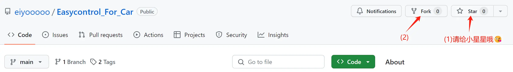
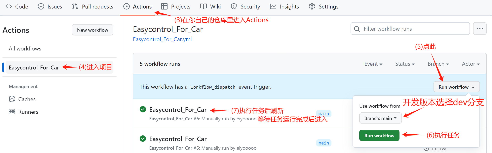
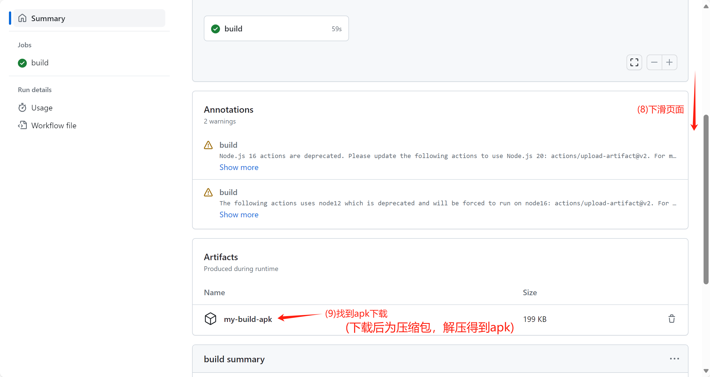
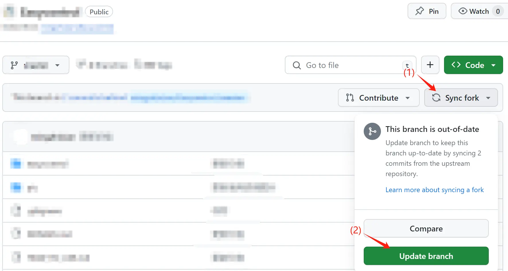

# 易控车机版(Easycontrol_For_Car)编译说明

### 此方法编译的apk不包含签名部分设备可能无法使用

### 注意：需要GitHub账号

## 项目有更新时切换到对应分支后按下图所示操作后重新执行上面的操作

---

## 🤖 用 GitHub Actions 构建（本 fork 推荐）

本仓库内置工作流：`.github/workflows/Easycontrol_For_Car.yml`。

**步骤**

1. 打开仓库的 [Actions](https://github.com/birdnofoots/Easycontrol_For_Car/actions) 页面
2. 左侧选择 **Easycontrol_For_Car** 工作流
3. 右上角 **Run workflow** → 选择分支 `main` → **Run workflow**
4. 等待构建完成（约 1~3 分钟），在运行详情页底部 **Artifacts** 下载 `app-debug`（保留 14 天）

**产物**

- `app-debug.apk`：debug 签名，可直接安装
- 同时会构建 `:server:copyRelease`（server 端 jar 会打包进 APK 资源）

> ⚠️ **注意**：fork 仓库的 push / pull_request **不会自动触发** Actions（GitHub 安全策略，避免 fork 滥用上游额度）。
> 因此每次推送代码后，需要**手动 Run workflow**。
> 若希望 push 自动触发，可在仓库 `.github/workflows/` 中保留 `workflow_dispatch` 并手动触发，或将仓库转为非 fork（不建议，会丢失与上游的关联）。

**常见构建失败原因**

| 报错 | 原因 | 处理 |
|---|---|---|
| `cannot find symbol`（Java 编译） | 代码引用了不存在的 API/方法 | 本地无 Android SDK 时难以发现，看 Actions 日志修正后重新触发 |
| `Failed to restore gradle cache` | GitHub 缓存服务抖动 | 属 warning，不影响构建 |
| `Node.js 20 is deprecated` | action 版本较旧 | 属 warning，功能正常 |
