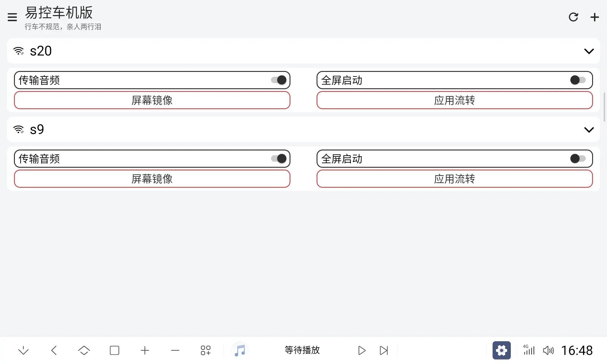
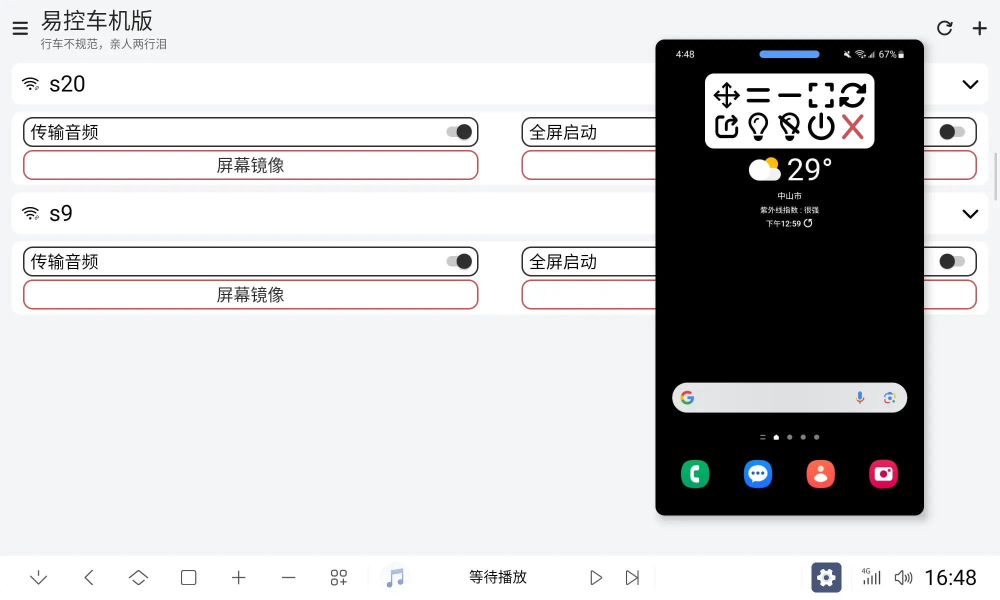
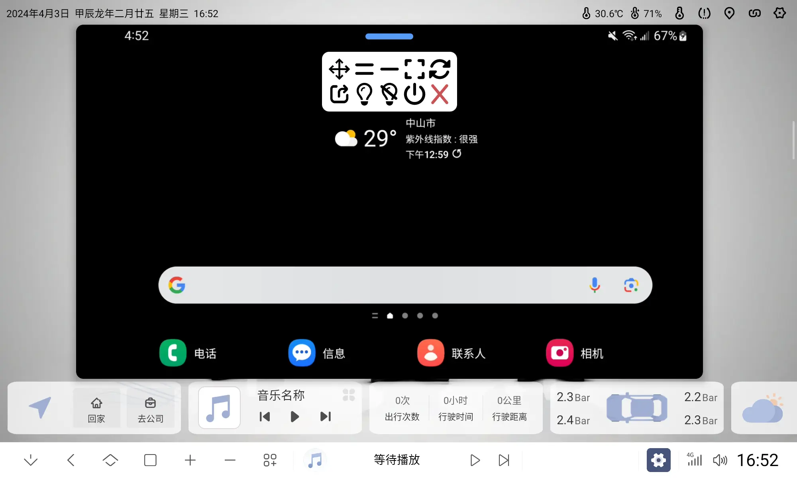
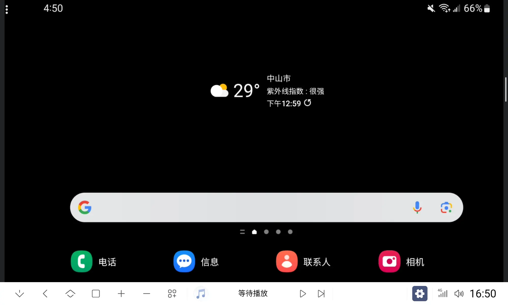

# 易控车机版(Easycontrol_For_Car)

> **🚧 本仓库为 fork 版本（birdnofoots/Easycontrol_For_Car）**
>
> **项目源头（原版）**: <https://github.com/eiyooooo/Easycontrol_For_Car> by [@eiyooooo](https://github.com/eiyooooo)
>
> 本 fork 在原版基础上新增了 **多 IP/域名地址池** 支持，原版的所有功能保持不变。
> 原作者的版权与 GPL-3.0 许可证完整保留，详见 [LICENSE](./LICENSE)。
>
> 反馈原版问题请到 [原仓库 Issues](https://github.com/eiyooooo/Easycontrol_For_Car/issues)，
> 本 fork 的问题请到 [本仓库 Issues](https://github.com/birdnofoots/Easycontrol_For_Car/issues)。

---

## ✨ 本 fork 新增功能 (v1.7.0+)

### 多 IP/域名地址池（Address Pool）

**痛点**：原版每个设备只能填一个地址。但同一台手机/车机在不同网络环境下 IP 经常变化（家里、公司、咖啡馆、公共 WiFi、4G/5G…），每次切换网络都要去软件里改一遍 IP，非常麻烦。

**解决**：现在可以给一个设备配置 **多个 IP/域名**，连接时**任一可用即视为成功**。

#### 使用场景

| 场景 | 地址池示例 |
|---|---|
| 家里 | `192.168.1.10:5555` |
| 公司 | `10.0.0.15:5555` |
| 4G 热点（域名） | `myphone.ddns.net:5555` |
| 路由器 DNS 解析 | `phone.local:5555` |

#### 使用方法

1. **添加设备** → "地址池"区域 → 输入第一个地址
2. 点 **"+ 添加地址"** 增加更多行
3. 同一行的 **"删除"** 按钮移除该地址（至少保留一行）
4. 点 **"扫描"** 把局域网扫描到的 IP 自动填到第一个空行
5. **保存** → 设备即可"任一地址连通即连接"

#### 连接策略

- **并行尝试**：所有地址同时发起连接
- **首个成功即用**：用 6s 整体超时（不是 N×5s）
- 失败：弹"无法连接"提示，可以改地址

#### 数据迁移

- 老版本（V1.6.10）数据库自动升级（v19 → v20）
- 旧的 `address` 字段自动包装为单元素地址池
- 无需手动迁移数据

---

## ⚠️ 原版声明（来自原作者）

> #### "易控车机版"**永久免费**，不会收取任何费用，也不会强制要求捐赠。请勿相信任何收费的"易控车机版"，以免上当受骗
>
> #### 本软件开源许可证为**GPL-3.0**，任何人可以免费使用、修改、分发，但请遵守开源许可证的规定
>
> #### 本项目**原版**唯一地址为 <https://github.com/eiyooooo/Easycontrol_For_Car>
>
> 反馈原版问题请到 [Issues](https://github.com/eiyooooo/Easycontrol_For_Car/issues)，功能建议请到 [Discussions](https://github.com/eiyooooo/Easycontrol_For_Car/discussions)

---

## 📖 原版简介

本软件可实现手机屏幕镜像到车机、手机应用流转到车机

- **车机支持**：能够安装第三方软件、基于安卓系统的车机
- **手机支持**：能够打开开发者调试(ADB)功能、基于安卓系统的手机

## 📥 安装包

### 本 fork（含多地址功能 + 代码审查修复）

| 来源 | 链接 | 说明 |
|---|---|---|
| **Release（推荐）** | [v1.7.1](https://github.com/birdnofoots/Easycontrol_For_Car/releases/tag/v1.7.1) | `versionCode 10701` / `versionName 1.7.1` |
| 直接下载（release） | [Easycontrol_For_Car-v1.7.1-release.apk](https://github.com/birdnofoots/Easycontrol_For_Car/releases/download/v1.7.1/Easycontrol_For_Car-v1.7.1-release.apk) | `debuggable=false`，**推荐** |
| 直接下载（debug） | [Easycontrol_For_Car-v1.7.1-debug.apk](https://github.com/birdnofoots/Easycontrol_For_Car/releases/download/v1.7.1/Easycontrol_For_Car-v1.7.1-debug.apk) | 含调试特性 |
| 旧版本 v1.7.0 | [v1.7.0](https://github.com/birdnofoots/Easycontrol_For_Car/releases/tag/v1.7.0) | ⚠️ 多地址连接有缺陷，见下 |
| CI 最新构建 | [Actions](https://github.com/birdnofoots/Easycontrol_For_Car/actions) | 每次构建产物，artifact 保留 14 天 |

> ⚠️ **v1.7.0 的已知缺陷**：地址池里如果**第一个地址不可达**，即使后面有能连上的地址也不会连接
> （只能把可用地址放到第一行，等于退化成单地址）。已在 **v1.7.1 修复**，请升级。

#### 🔐 签名

本版本起使用**固定签名密钥**（此前每次 CI 构建都会生成随机 debug 密钥，
导致 APK 之间无法互相覆盖安装）。两个变体使用同一把密钥，可互相覆盖安装。

| 项 | 值 |
|---|---|
| 证书主体 | `CN=Easycontrol For Car (Fork), OU=birdnofoots, O=Easycontrol_For_Car` |
| 密钥算法 | RSA 4096 / SHA384withRSA（有效期至 2054-03-02） |
| **证书 SHA1** | `C9:E6:08:39:91:A9:C6:3D:7A:0C:DE:11:05:03:48:99:E8:1B:65:13` |
| 签名方案 | v1 + v2 + v3 |

核对方法：`keytool -printcert -jarfile 你的.apk`

> ⚠️ 由于更换了签名密钥，**从旧包升级（原版 / 早期构建 / 第三方重签名版）
> 必须先卸载一次**；自 v1.7.0（固定签名）起，之后所有版本都能直接覆盖安装。
> 若设备上存在**应用分身**（独立用户）里的同包名残留，也会触发
> `INSTALL_FAILED_UPDATE_INCOMPATIBLE`，需一并卸载：
> `pm uninstall --user <分身用户ID> top.eiyooooo.easycontrol.app`
>
> 备份建议：升级前可备份应用数据目录 `databases/app.db`（含设备地址池配置）。

### 原版

- <https://github.com/eiyooooo/Easycontrol_For_Car/releases>

### 🔄 升级 / 降级说明

- **升级（V1.6.10 → V1.7.0）**：数据库自动迁移（v19 → v20），旧的单地址自动变为"单元素地址池"，无需手动操作
- **降级（V1.7.0 → V1.6.10 等低版本）**：v1.7.0 已实现 `onDowngrade`，重建数据表且尽量保留设备配置，不会再启动崩溃
- 跨版本回退前建议备份 `app.db`（位于应用私有目录）

## 📘 使用说明

- 建议在软件内阅读
  - 首次打开软件将会显示
  - 亦可在软件设置中再次打开
- [HOW_TO_USE.md](./HOW_TO_USE.md)

## 🛠️ 编译

- [HOW_TO_BUILD.md](./HOW_TO_BUILD.md)
- 或直接用本仓库的 GitHub Actions：`.github/workflows/Easycontrol_For_Car.yml`

## 📜 变更日志 (Changelog)

### v1.7.0 (2026-10-15) — 本 fork 版本
- 🆕 **多 IP/域名地址池**：单个设备可配置多个连接地址，任一可用即连接
- 🆕 动态行 UI：添加/删除地址行无需重新打开对话框
- 🆕 扫描局域网 IP 一键加入地址池
- 🆕 数据库自动迁移（v19 → v20）
- 🆕 兼容旧版本单地址数据
- 🔧 升级 GitHub Actions：upload-artifact v2 → v4
- 🛡️ 代码审查修复（2026-10-15）：
  - 新增 `onDowngrade`：降级安装不再启动崩溃，并尽量保留设备数据
  - `onUpgrade` 恢复整表重建策略：从更早历史版本升级不再因缺列崩溃
  - `tryConnectAny` 改为全局 deadline 超时，放弃等待后回收在途连接（修 socket 泄漏）
  - `Device.addresses` 私有化 + `getAddresses()` 返回副本（防绕过同步、防并发修改异常）
  - `Adb.adbMap` 改用 `ConcurrentHashMap`；`copyDevice` 空列表回退到 `address`
  - 保存设备时比较完整地址列表（原来只比第一个地址）
  - versionCode/versionName 对齐 1.7.0 (10700)
- 🔐 构建改为**固定签名**（GitHub Secrets 注入密钥库），解决每次 CI 构建
  签名随机导致无法覆盖安装的问题；一次构建产出 debug + release 双包
- 🐛 release 关闭 R8 混淆：真机实测混淆后启动即崩（`MainActivity.onPause()` NPE），
  本项目依赖 hidden API bypass / 反射，混淆风险高，暂不开启

### v1.7.1 (2026-10-16)
- 🐛 **修复多地址连接缺陷**：原实现并行发起连接，但主流程**按列表顺序**等待结果，
  会被排在前面的不可达地址拖住（真机实测约 3.9s），超过连接看门狗（5s）导致
  "第一个地址不通就整体连不上"。现改为**先完成者优先**（ExecutorCompletionService）：
  - 真机实测对照（同一网络、同一地址列表，仅改等待策略）：`3233 ms` → `9 ms`
  - 全局等待上限由 6s 收紧到 4.5s，保证失败路径可预期
- 🐛 收紧连接登记与回收逻辑（AtomicReference 唯一登记），避免放弃等待瞬间的 socket 泄漏
- 🔢 versionCode 10700 → 10701

### v1.7.0 — 本 fork 版本（⚠️ 多地址连接有缺陷，建议用 v1.7.1）
- 来自上游 [eiyooooo/Easycontrol_For_Car](https://github.com/eiyooooo/Easycontrol_For_Car) 同步

---

## 📷 截图

## 🙏 致谢

- **原作者 [@eiyooooo](https://github.com/eiyooooo)**：开发并维护易控车机版
- **原仓库 [eiyooooo/Easycontrol_For_Car](https://github.com/eiyooooo/Easycontrol_For_Car)**：本 fork 的项目源头
- 所有为本项目和原项目贡献代码、反馈问题、捐赠支持的开发者与用户

## 💝 捐赠

- **本 fork 不接受任何捐赠**（不强制、不收集）
- 如果觉得好用，欢迎向**原作者**捐赠：<https://github.com/eiyooooo/Easycontrol_For_Car>

---

## 📄 许可证

本项目采用 **GPL-3.0** 许可证，详见 [LICENSE](./LICENSE)。

原版权属 [@eiyooooo](https://github.com/eiyooooo) 所有，本 fork 仅为功能增强。
